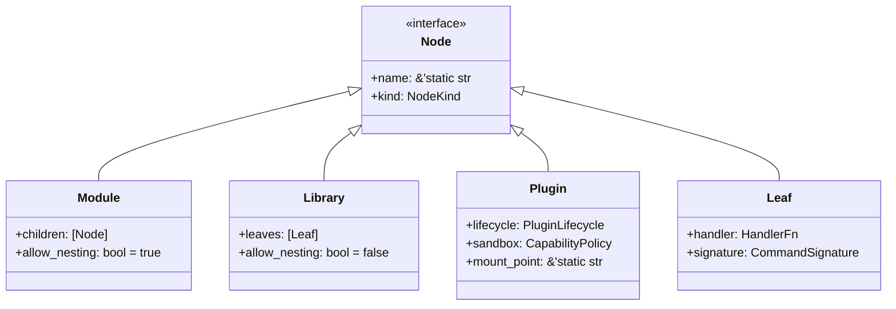
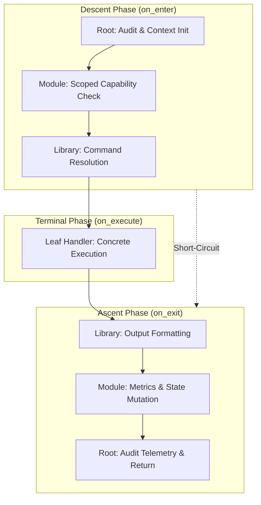

# modtree Architecture Specification

This document defines the technical architecture, domain taxonomy, execution
lifecycle, and zero-allocation contracts of `modtree`.

---

## 1. Architectural Motivation & Scope

Modular systems traditionally suffer from an impedance mismatch between static
compile-time safety and dynamic runtime extensibility:

1. **Object-Oriented Dynamic Trees**: Typical OOP command systems rely on
   polymorphic pointer chasing (`Box<dyn Command>`, `Arc<Mutex<dyn Handler>>`),
   causing cache misses, heap fragmentation, and unpredictable latency.
2. **Monolithic Flat Registries**: Flat registries (such as simple string-to-handler
   hash maps) lose structural hierarchy, contextual permission inheritance,
   and scoped lifecycle management.
3. **Coupled Infrastructure**: Many routing engines entangle command routing
   with state storage, transport serialization, and container isolation.

`modtree` addresses these problems by providing a high-performance,
hierarchical tree composition and routing engine governed by the following
tenets:

- **Orthogonal Separation**: Routing topology (`modtree`), state storage
  (`statefs`), and isolation sandboxes (capsules/containers) remain strictly
  decoupled.
- **Hybrid Monomorphism**: Static compile-time subtrees achieve zero-cost
  inlined dispatch, while dynamic mount points permit runtime plugins without
  compromising core throughput.
- **Bounded U-Cycle Traversal**: Root-to-leaf descent (`on_enter`), terminal
  execution (`on_execute`), and leaf-to-root ascent (`on_exit`) enforce
  capability checks and cleanup with zero dynamic memory allocation.

---

## 2. Domain Taxonomy & Node Hierarchy

Every element in a `modtree` hierarchy is a node. Nodes are classified into
four distinct structural roles based on their invariants and nesting rules:

### 2.1 Taxonomy Matrix

<!-- markdownlint-disable MD013 -->
| Node Type | Can Have Children | Child Constraints | Primary Purpose | Dispatch Model |
| :--- | :--- | :--- | :--- | :--- |
| **`Module`** | Yes | Any `Node` (`Module`, `Library`, `Plugin`, `Leaf`) | Structural branching & namespace nesting | Static / Monomorphic |
| **`Library`** | Yes (Restricted) | `Leaf` nodes only (no nested branches) | Grouping flat utility commands | Static / Direct index |
| **`Plugin`** | Yes | Dynamic subtrees | Runtime extension & isolated capability boundary | Dynamic Mount / FFI Boundary |
| **`Leaf`** | No | None (Terminal) | Concrete executable command / action handler | Direct execution |
<!-- markdownlint-enable MD013 -->

### 2.2 Structural Invariants

1. **Terminal Constraint on `Library`**: A `Library` node cannot contain
   nested `Module` or `Library` nodes. Its children are strictly terminal
   `Leaf` instances. This prevents arbitrary nesting where simple command
   grouping is intended.
2. **Capability Inheritance on Descent**: Child nodes inherit capability
   restrictions from their parent `Module` or `Plugin` during the descent phase.
   A child cannot expand capabilities beyond what its ancestors permit.
3. **Mount Point Isolation**: A `Plugin` node mounts onto an explicit path in
   the tree. Unloading or reloading a `Plugin` atomically modifies that mount
   point without invalidating sibling branches.

---

## 3. Traversal Lifecycle: The Sewing Machine Architecture (SMA)

Routing and command execution in `modtree` adopt the Sewing Machine
Architecture (SMA) traversal cycle:

### 3.1 Lifecycle Phases

1. **Descent Phase (`on_enter`)**:
   - Traversal begins at the `Root` and traverses downward towards the
     target `Leaf`.
   - At each ancestor node, `on_enter(&mut Context) -> FlowControl` is invoked.
   - Nodes inspect permissions, apply rate limits, or inject scoped resources.
   - If any node returns `FlowControl::Halt(reason)`, traversal terminates
     immediately and switches to the ascent phase. No downstream nodes or leaves
     are invoked.

2. **Terminal Execution Phase (`on_execute`)**:
   - Reached only if all ancestors along the path permitted traversal with
     `FlowControl::Continue`.
   - The targeted `Leaf` executes its handler using the accumulated `Context`.
   - Returns a typed `ExecutionResult`.

3. **Ascent Phase (`on_exit`)**:
   - Traversal rewinds back up the path towards the `Root`.
   - At each node, `on_exit(&mut Context, &ExecutionResult)` is invoked in
     reverse order.
   - Used for telemetry, auditing, cache synchronization, and transaction
     cleanup (e.g. rollbacks upon failure).

---

## 4. Scrooge Systems Mindset: Mechanical Sympathy

To ensure zero-allocation operation on the hot execution path:

1. **Contiguous Node Arenas**: In dynamic trees, nodes are allocated within
   contiguous memory arenas rather than fragmented heap allocations.
2. **64-Byte Cache Line Alignment**: Node lookup descriptors and routing entries
   are sized to align cleanly within 64-byte L1 cache lines, avoiding cache-line
   straddling.
3. **Zero-Allocation Routing**: Path matching operates over byte slices
   (`&[u8]`) or interned symbol identifiers (`SymbolId: u32`) without
   constructing intermediate `String` or `Vec` objects.
4. **Failure Transparency**: Traversal halts return explicit typed errors
   (`RoutingError`, `AccessDenied`, `LeafNotFound`). Silent drops or empty
   defaults are strictly prohibited.

---

## 5. Integration with Sister Ecosystems

`modtree` serves as the routing backbone across several core systems:

- **`statefs`**: Nodes in `modtree` can mount dynamic state projections from
  `statefs`, mapping `/ops/...` actions directly to underlying `/state/...`
  variables.
- **`GoldSrc.rs`**: Replaces legacy dynamic plugin registration tables
  (such as AMX Mod X forwards/natives) with a statically validated,
  hierarchical command and event routing tree.
- **CLI Frameworks**: Directly acts as a high-performance execution engine for
  hierarchical CLI applications without runtime reflection.

---

## 6. Tiered Developer Experience & Macro Architecture

To balance mechanical sympathy with ergonomic developer experience,
`modtree` implements a 3-tier API model:

### 6.1 Tier 1: Attribute Macros (`modtree-macros`)

Declarative domain structs annotated with attributes:

- `#[modtree::module]`: Transforms a struct into a composite `ModuleNode`.
  Inspects child struct fields and automatically calls `mount(field)` for any
  field implementing `IntoTreeNode`.
- `#[modtree::library]`: Annotates an `impl` block or struct. Extracts all
  methods marked with `#[modtree::command]` and mounts them as terminal
  `LeafNode` instances.
- Granular Metadata: `#[modtree::name]`, `#[modtree::enter]`, `#[modtree::exit]`,
  `#[modtree::context]`, `#[modtree::intent]`, `#[modtree::outcome]`,
  `#[modtree::error]`. Direct function identifiers are used without string quotes,
  enabling IDE autocompletion, Go-to-Definition, and compile-time signature checks.

### 6.2 Tier 2: Typestate Fluent Builder

Imperative builders for dynamic and runtime module assembly:

- `ModuleNode::named(name).with_mounted(child)`
- `LibraryNode::named(name).with_leaf(leaf)`

The typestate pattern restricts `LibraryNode` from exposing general mounting
methods, preventing invalid child adoption at compile-time.

### 6.3 Tier 3: Core Zero-Allocation Traversal

The foundation executing the U-cycle traversal across `TreeNode` instances on
the CPU call stack without allocating heap memory during resolution.

---

## 7. Versioning & Stability Guarantees

`modtree-rs` adheres to Semantic Versioning (SemVer 2.0.0):

- **Major (x.0.0)**: Breaking changes to trait signatures (`IntoTreeNode`,
  `NodeHook`), traversal lifecycles, or public ABI.
- **Minor (0.x.0)**: New macro attributes, adapters, or non-breaking API additions.
- **Patch (0.0.x)**: Performance optimizations, internal documentation, or bug fixes.
